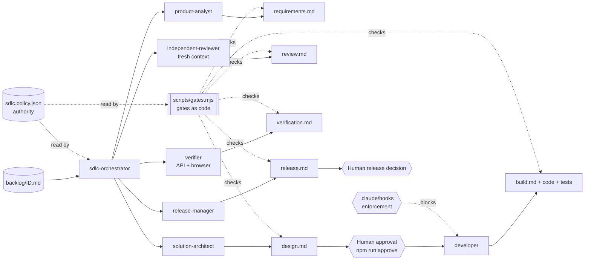

# Architecture

How the framework (`docs/framework.md`) is implemented in this repository, and why each piece is
built the way it is.

## Components

| Plane | Where it lives | Mechanism |
|---|---|---|
| Identity | `.claude/agents/*.md`, `## Sign-off` in every artefact | One named agent per stage; the gate checks that the right agent signed |
| Authority | `sdlc.policy.json` | Stage levels, human-approval stages, per-agent write scopes, enforcement switches |
| Enforcement | `.claude/hooks/*.mjs`, `.claude/settings.json` | Code locked before an approved design; tests cannot be weakened; approvals cannot be forged; no push to main, no merge, no policy edits |
| Evidence | `changes/<ID>/` | Six artefacts plus `gates.json` per change; CI re-checks every change |

## Flow of one change

1. `npm run change:new -- BUG-001` creates `changes/BUG-001/requirements.md` and sets the current change.
2. **Discover:** the analyst writes testable ACs mapped to rules. **G1** checks the Given/When/Then form, that every cited rule exists, and that no open questions remain.
3. **Design:** the architect writes the approach, impact, risks and test strategy. **G2** needs a human approval: the orchestrator stops, and a human runs `npm run approve -- BUG-001 design --as <name>`.
4. **Build:** the developer writes failing tests, then code. The hook unlocked `app/src/` only after G2. **G3** checks for failing-before and passing-after evidence.
5. **Review:** a fresh reviewer sees only the artefacts, the diff and the test output. **G4** needs APPROVE, no blocking items, and a reviewer different from the builder.
6. **Verify:** the verifier checks every AC through the API and the browser (Playwright MCP). **G5** needs a PASS row with evidence for every AC.
7. **Release:** an evidence pack, risk and rollback, and a GO recommendation. **G6** needs a human approval.
8. `npm run gates -- BUG-001` writes `gates.json`. CI runs `npm run gates -- --all` on every push.

## Design decisions

**Gates are code, not a model's judgement.** An LLM saying "looks done" is not evidence. The checks
are deterministic, unit-tested and identical for humans and agents.

**Approvals are a separate channel.** Agents can write every artefact except the approval. The hook
blocks them from writing it, and settings deny the approve command to agents. A human approves from
their own terminal. This separates identity (who approved) from authority (who may) and enforcement (what stops forgery).

**Independence is structural.** The reviewer is a different agent in a fresh context that receives
only the artefacts. G4 rejects a review signed by the builder.

**Code is locked, not discouraged.** "Please don't code before the design is approved" in a prompt is
a request. A PreToolUse hook that refuses the edit is a control.

**Tests can only get stronger.** The cheapest way for any optimiser, human or agent, to make a failing
test pass is to weaken it. The hook makes that path unavailable.

**The demo app is small on purpose.** Money arithmetic with a real floating-point defect gives the
agents an objective oracle (exact fils), and the whole lifecycle fits in one sitting.

## Relationship to agentic-qa

The **Verify** stage applies the method of [agentic-qa-lean](https://github.com/OlgaManuilova-coder/agentic-qa-lean):
real-user browser checks against a business-rule oracle, with evidence per finding. For a product with a
large UI regression suite, plug agentic-qa in as the Verify stage. Its GO / NO-GO becomes G5 evidence.

---
*Part of the Agentic SDLC Framework © 2026 Olga Manuilova, licensed under [CC BY 4.0](../LICENSE-DOCS.md).*
